<div align="center">



<p>
  <a href="https://kie.ai"></a>
  <a href="https://claude.com/claude-code"></a>
  
  
</p>

<a href="https://git.io/typing-svg"></a>

**[English](#-english) · [Français](#-français)**

</div>

---

## 🇬🇧 English

A **Claude Code skill** that lets Claude generate **images, video, music and voice** with **any model on the [KIE.ai](https://kie.ai) list**, with no setup beyond an API key.

You give a prompt. Claude **optimizes it**, finds the right KIE model in the official docs, calls the API, waits for the result, downloads it and **shows it right in the conversation**.

### ✨ Features

| | |
|---|---|
| 🧠 **Prompt optimizer** | Turns a rough idea into a precise, model-ready prompt |
| 🌐 **Any KIE model** | Reads `docs.kie.ai` to find the model id and its exact parameters, so new models work too |
| 🖼️ **Inline preview** | Results are displayed large in the chat, ready to review |
| 🧩 **Reference images** | Auto-uploads your image for image-to-image and edits |
| ⚡ **Parallel variants** | Generate several versions at once |
| 🛡️ **Known pitfalls handled** | Unchanged-reference bug, misspelled text in images, Arabic text warning |

### 🚀 Install

1. Get an API key at **[kie.ai](https://kie.ai)**.
2. Copy `skills/kie-image` into your Claude skills folder:
   - **Windows:** `%USERPROFILE%\.claude\skills\`
   - **macOS / Linux:** `~/.claude/skills/`
3. Set your key as an environment variable (never commit it):

   ```powershell
   # Windows (PowerShell), then reopen Claude
   setx KIE_API_KEY "your-key-here"
   ```
   ```bash
   # macOS / Linux
   export KIE_API_KEY="your-key-here"
   ```

### 💬 Use it

Just talk to Claude:

> *Generate a luxury spa hero image with Nano Banana 2.1, 1K, 16:9, text space on the left.*
>
> *Make 5 minimal logos for my hotel with GPT Image 2.5.*
>
> *Create a 5s video of this product with Kling.*

### 🔄 How it works

```
Your prompt ─► Optimize ─► Find model in KIE docs ─► createTask ─► poll status ─► download ─► show inline
```

---

## 🇫🇷 Français

Un **skill Claude Code** qui permet à Claude de générer des **images, vidéos, musiques et voix** avec **n'importe quel modèle de la liste [KIE.ai](https://kie.ai)**. Seule une clé API est nécessaire.

Vous donnez un prompt. Claude **l'optimise**, trouve le bon modèle KIE dans la documentation officielle, appelle l'API, attend le résultat, le télécharge et **l'affiche directement dans la conversation**.

### ✨ Fonctionnalités

- 🧠 **Optimisation du prompt** : une idée brute devient un prompt précis
- 🌐 **Tous les modèles KIE** : le skill lit `docs.kie.ai` pour trouver l'identifiant et les paramètres exacts
- 🖼️ **Aperçu dans le chat** : les résultats s'affichent en grand
- 🧩 **Images de référence** : envoi automatique pour l'image-à-image et les retouches
- ⚡ **Variantes en parallèle** : plusieurs versions en une fois
- 🛡️ **Pièges connus gérés** : référence renvoyée sans changement, texte mal orthographié dans les images, avertissement pour l'arabe

### 🚀 Installation

1. Créez une clé API sur **[kie.ai](https://kie.ai)**.
2. Copiez `skills/kie-image` dans votre dossier de skills Claude (`%USERPROFILE%\.claude\skills\` sous Windows, `~/.claude/skills/` sous macOS/Linux).
3. Définissez la clé (ne la publiez jamais) :

   ```powershell
   setx KIE_API_KEY "votre-clé"   # puis rouvrez Claude
   ```

### 💬 Utilisation

> *Génère une image hero de spa de luxe avec Nano Banana 2.1, 1K, 16:9, espace libre à gauche pour le titre.*
>
> *Fais-moi 5 logos minimalistes pour mon hôtel avec GPT Image 2.5.*

---

## ⚠️ Notes

- Les textes générés dans les images (noms, arabe) peuvent contenir des erreurs : vérifiez toujours l'orthographe.
- Les images produites sont des PNG, pas des fichiers vectoriels.
- Les coûts dépendent du modèle (environ 3 crédits pour une image 1K sur les modèles testés).

## 👤 Author

<div align="center">

**BENHAND STUDIO**

[](https://github.com/mohamedbenhandil)

<sub>Not affiliated with KIE.ai or Anthropic. KIE and Claude names and logos belong to their respective owners.</sub>

</div>
